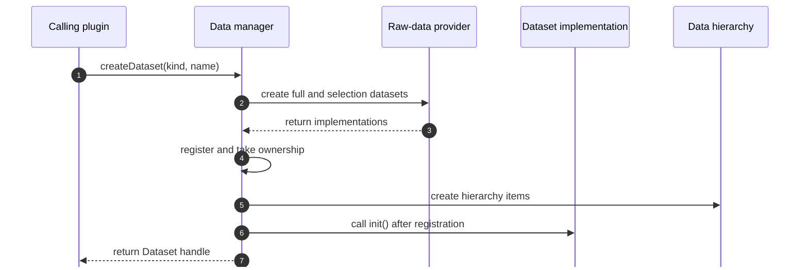

# Creating and removing datasets

Create registered datasets through `mv::data()`. The manager selects the raw-data plugin, creates the implementation and selection dataset, assumes ownership, places the dataset in the hierarchy, initializes it, and emits the relevant notifications.

```cpp
auto points = mv::data().createDataset<Points>(
    "Points",
    "Imported measurements");

if (!points.isValid())
    return;

// Populate the dataset through the concrete Points API.
```

The first argument is the registered data-plugin kind. The second is the name displayed to users. Supplying an explicit ID and disabling notification are restoration-oriented facilities; ordinary plugin code should keep their defaults.

The creation path passes through the data manager and the provider registered for the requested kind:



## Hierarchy parent

Pass a valid parent handle to place the new dataset below that parent:

```cpp
auto child = mv::data().createDataset<Points>(
    "Points",
    "Projected measurements",
    parentDataset);
```

This establishes hierarchy parentage only. Use `createDerivedDataset()` when the new dataset also has source lineage.

## Initialization order

The manager registers the implementation and hierarchy item before calling `DatasetImpl::init()`. Concrete data implementations can use `init()` for actions or state that requires registration to be complete. Populate domain data according to the concrete type's contract and emit its data-change notification after the state is consistent.

## Removing data

Ask the manager to remove datasets:

```cpp
if (dataset.isValid())
    mv::data().removeDataset(dataset);
```

Removal can affect descendants, derived datasets, selection datasets, analysis plugins, and the underlying raw-data instance. Locked datasets defer removal until they are unlocked. Do not manually delete a registered `DatasetImpl`.

During `aboutToBeRemoved`, the implementation is still available for final detachment. After removal, handles are invalid and consumers should retain only the ID or copied metadata needed for cleanup.

## Batch removal

`removeDatasets()` handles hierarchy-aware removal and may ask the user how descendants should be treated. Use it for user-directed multi-selection removal. Core-controlled cleanup can use the appropriate manager operation when no interactive choice is required.
