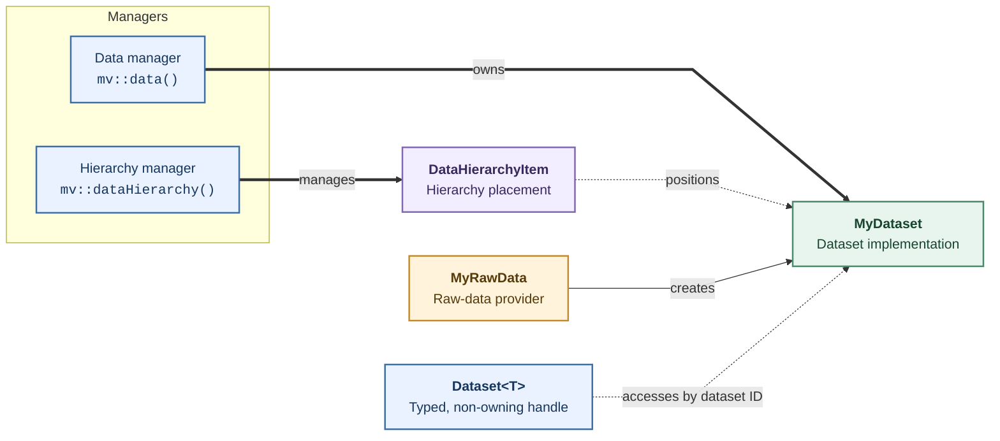

# Mental model

ManiVault separates data identity, implementation, storage, hierarchy, and selection. Understanding those roles prevents most lifetime and relationship mistakes.

## The principal types

`Dataset<T>` is the handle passed between plugins. It stores a dataset identifier and, while the dataset exists, access to its implementation. It also translates core dataset events into convenient Qt signals.

`DatasetImpl` is the polymorphic base implemented by concrete data plugins such as point, image, cluster, color, or text data. It exposes common metadata, hierarchy, selection, locking, grouping, linked-data, task, and serialization behavior.

`AbstractDataManager` owns registered dataset implementations and is the supported entry point for creating, finding, grouping, and removing datasets. Access it with `mv::data()`.

`DataHierarchyItem` represents a dataset's position and presentation in the data hierarchy. `AbstractDataHierarchyManager`, available through `mv::dataHierarchy()`, manages those items and their UI selection.

`plugin::RawData` and its factory define a concrete data kind and create its `DatasetImpl` instances. Despite its name, a raw-data plugin is the factory-backed provider for one registered dataset kind.

The relationships between these types are summarized below. The data manager owns dataset implementations, the hierarchy manager owns their presentation items, and plugins exchange non-owning `Dataset<T>` handles.

## Ownership

The data manager owns registered `DatasetImpl` objects. A `Dataset<T>` neither deletes the implementation nor keeps a removed dataset alive. When the core removes a dataset, retained handles are reset and become invalid.

This yields a simple rule:

- retain `Dataset<T>` handles in plugins and actions;
- never retain an implementation pointer as an ownership mechanism;
- ask the data manager to create and remove registered datasets;
- check a handle before every use that is separated from acquisition by callbacks, queued signals, or asynchronous execution.

## Three independent relationships

A dataset can participate in three different structures:

1. **Hierarchy parentage** controls where it appears in the data hierarchy.
2. **Derived-source lineage** records that one full dataset derives from another and may share its selection.
3. **Full/subset lineage** records the original full dataset from which a selected subset was copied.

The same dataset can have values for all three, and they are not interchangeable. Passing a hierarchy parent when creating data does not make the new dataset derived from that parent. Likewise, a derived dataset is placed below its source by default, but callers can supply another hierarchy parent.

## Storage and proxy datasets

An owning dataset has its own raw storage. A proxy dataset represents a collection of member datasets and delegates data access according to its concrete implementation. `DatasetImpl::StorageType` and the proxy-member API describe that distinction. Plugin code should use the concrete data type's accessors rather than assume every dataset owns one contiguous buffer.
